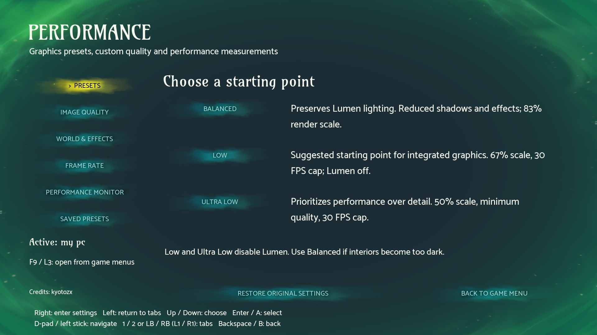
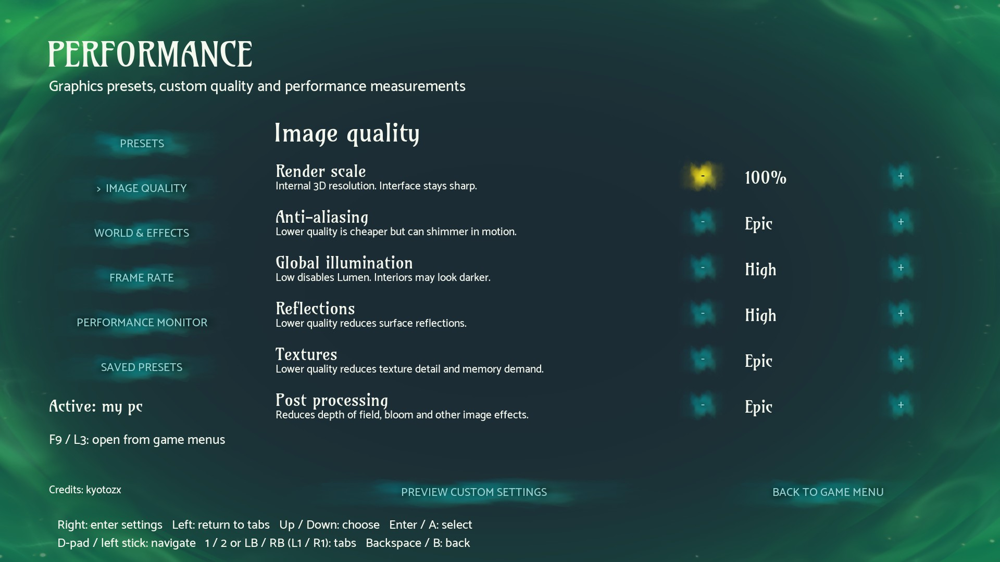
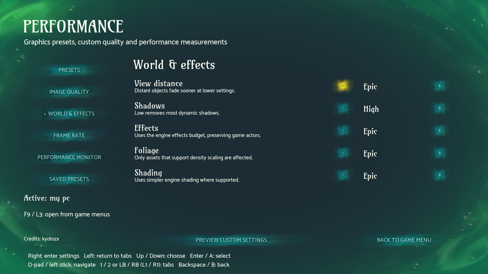
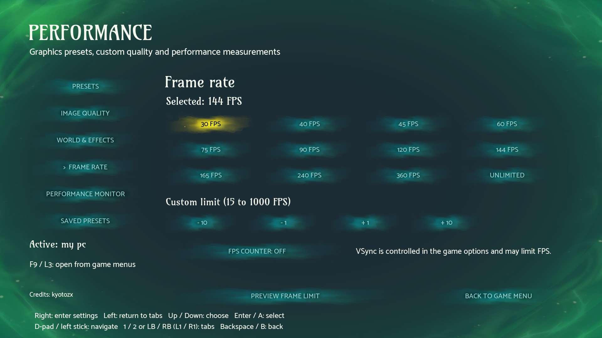
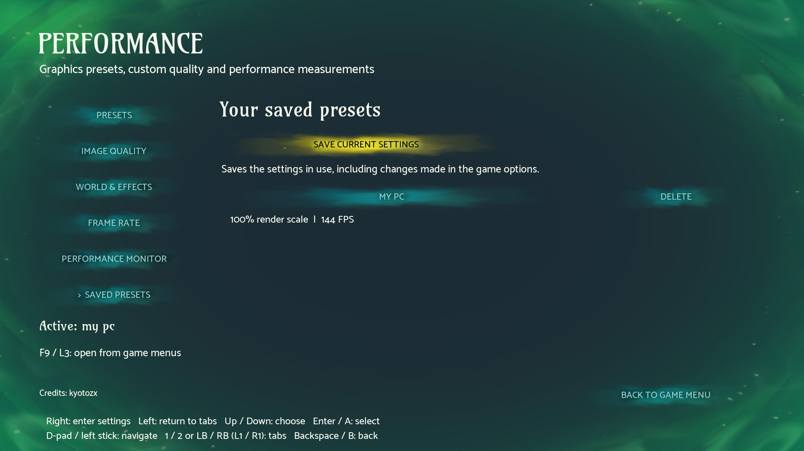
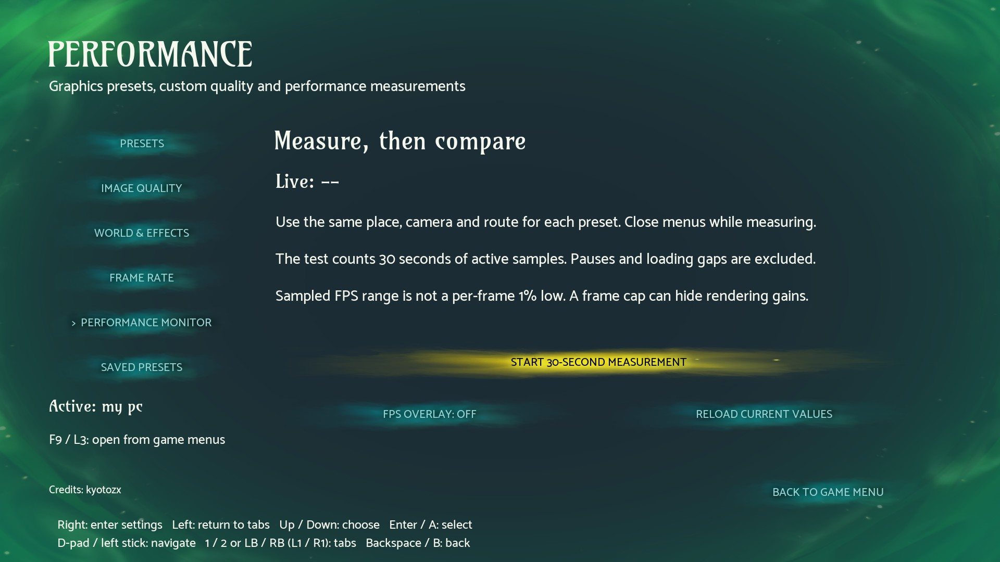

<p align="center"></p>

# Performance

Graphics presets, custom settings and FPS controls for **Warrior Cats: Clans of the Forest**, with menus that use the game's own fonts, buttons and backgrounds.

[Download Performance](https://github.com/kyotozx/warrior-cats-performance/releases/latest) · [Get Clan Loader](https://github.com/kyotozx/warrior-cats-clan-tools/releases) · [Report a bug](https://github.com/kyotozx/warrior-cats-performance/issues)



## Features

- **Balanced, Low and Ultra Low presets**, with a preview before you commit.
- **Individual quality controls** for render scale, lighting, shadows, reflections, textures, anti-aliasing, effects, foliage, view distance and shading.
- **Custom or unlimited FPS**, including presets up to 360 FPS and custom values from 15 to 1000.
- **Optional FPS counter** and a 30-second measurement to compare your settings.
- **Up to 24 named presets** that capture your current graphics configuration.
- **20-second confirmation timer**, automatic preview recovery and a button to restore your original settings.
- **Keyboard and controller navigation** throughout, including the preset naming screen.

| Image quality | World and effects |
| --- | --- |
|  |  |

| Frame rate | Saved presets |
| --- | --- |
|  |  |

<details>
<summary>Performance monitor</summary>



</details>

## Install

Requires the Windows Steam game, build **24847281**, and **Clan Loader 0.3.0-rc5 or newer**. Clan Tools is optional.

1. Save and close the game.
2. Install or update [Clan Loader](https://github.com/kyotozx/warrior-cats-clan-tools/releases) using its release ZIP and **Install / update suite**. If you only want Performance, disable Clan Tools in the manager afterward.
3. Download `Performance-0.2.0.zip` from [Releases](https://github.com/kyotozx/warrior-cats-performance/releases/latest). Keep this ZIP intact.
4. In Clan Loader, choose **Add mod package**, select the Performance ZIP and leave Performance enabled.
5. Start the game. Open **Performance** from the original main, pause or settings menu with **F9 / L3**.

The GitHub source archives are for development. Install the named Performance ZIP through the manager.

No graphics preset is applied on a fresh install. When upgrading from Clan Tools, your existing FPS counter preference and custom frame-limit behavior are imported if Performance has no preferences yet. Existing Performance preferences take priority. Update Clan Tools to rc5 or newer to remove its previous FPS controls and counter.

## Controls

| Action | Keyboard | Controller |
| --- | --- | --- |
| Open from game menus | F9 (F8 also works) | L3 / left stick click |
| Navigate | Arrow keys | D-pad / left stick |
| Select | Enter | A / Cross |
| Back | Backspace | B / Circle |
| Switch tabs | 1 / 2 | LB / RB |

Select a tab or press Right to enter its controls. Left returns toward the sidebar. All interface text is in English; a mouse is not required.

## Choosing settings

| Preset | Render scale | Frame limit | Lighting |
| --- | --- | --- | --- |
| Balanced | 83% | 60 FPS | Lumen retained |
| Low | 67% | 30 FPS | Lumen disabled |
| Ultra Low | 50% | 30 FPS | Lumen disabled |

Low is a starting point for integrated graphics. Lower render scale reduces 3D clarity while keeping menus sharp. Disabling Lumen can make interiors darker. VSync remains in the original game options and can limit FPS even when Unlimited is selected.

Choose **Saved presets > Save current settings** to keep your own setup. This captures the values currently in use, including supported changes from the game's options. Preview and keep pending edits before saving them as a preset.

Settings are stored in `ue4ss/Mods/ClanPerformance/preferences.json`. Updates preserve this file. The internal folder name stays `ClanPerformance` for compatibility with earlier versions.

## Recovery and limits

Use **Restore original settings** and confirm before uninstalling if you want to return to the settings captured before your first change. Confirmed engine settings can remain after removing the mod. Interrupted previews are recovered on the next launch with Performance enabled.

Performance adjusts engine graphics settings. It does not guarantee a particular FPS or fix every source of stuttering. Compare the same location and route with the same frame cap. The monitor reports sampled FPS, not per-frame 1% lows.

The mod does not edit story saves, enemies or quests. Game art and fonts are loaded from your installation and are not bundled. This is an unofficial community mod.

## Development

Lua 5.4 and Windows PowerShell are enough to run the tests and build the package:

```powershell
./scripts/Test.ps1 -LuaPath lua
./mods/ClanPerformance/Build-Package.ps1
```

Source is in `mods/ClanPerformance/Scripts`; regression tests are in `mods/ClanPerformance/tests`. The package uses Clan Loader API 1. The game runtime is UE4SS, supplied by Clan Loader.

**Pull requests are welcome.** See [CONTRIBUTING.md](CONTRIBUTING.md). Original code and the emblem are [MIT licensed](LICENSE); `json.lua` retains its included rxi MIT notice.

Credits: kyotozx
